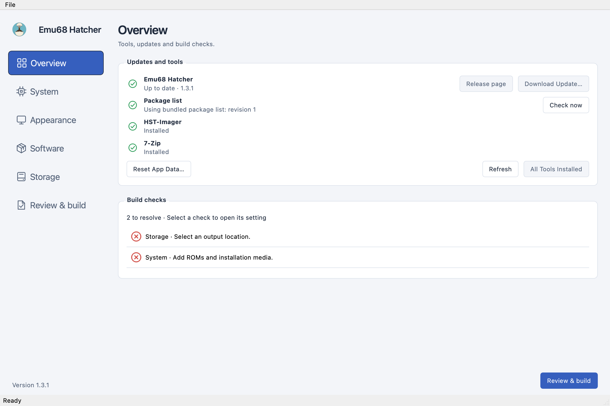
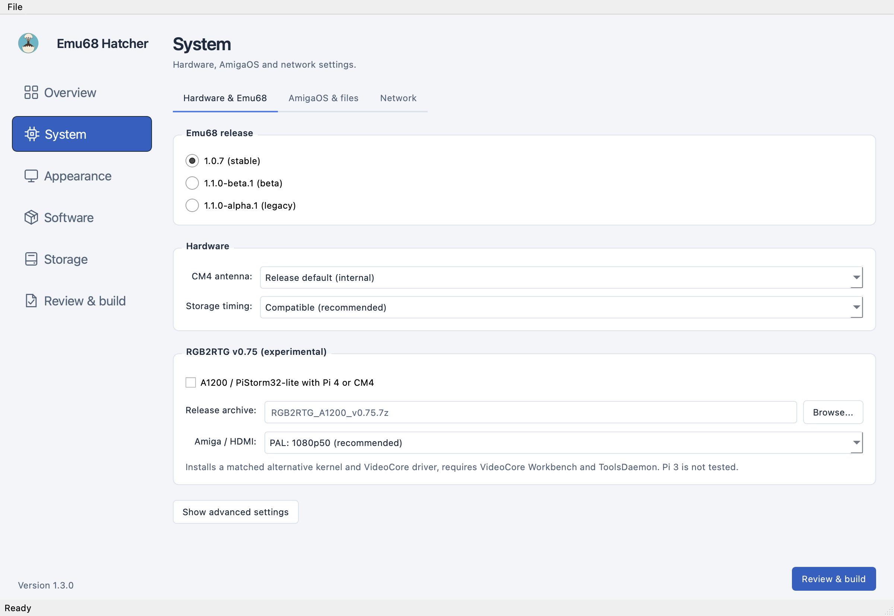
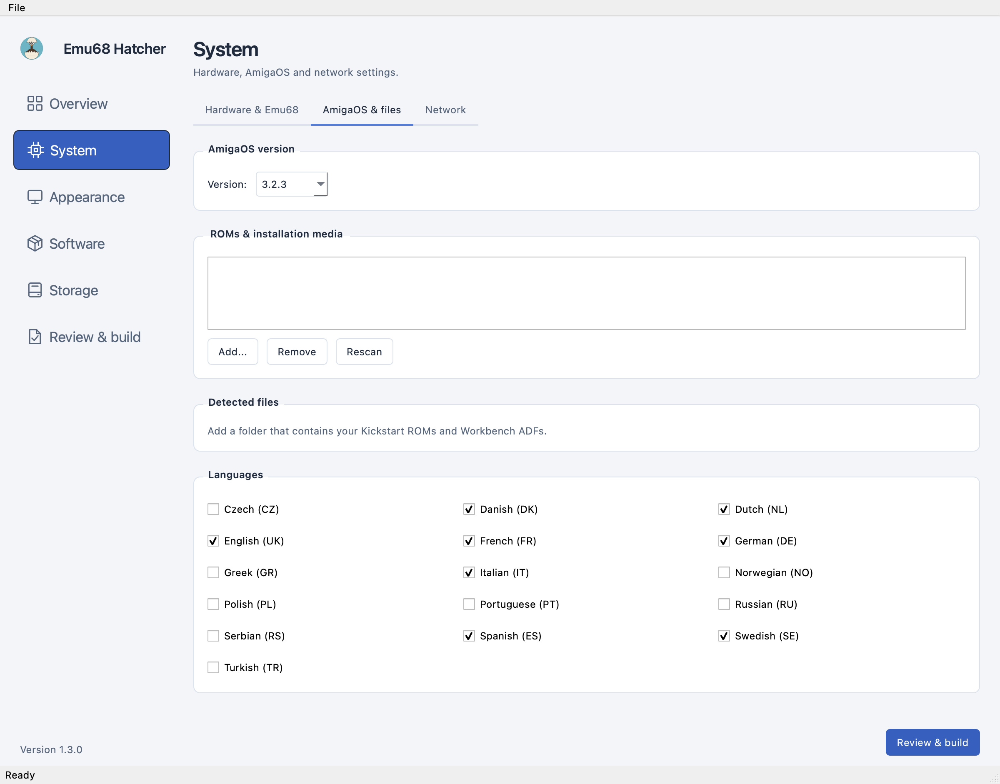
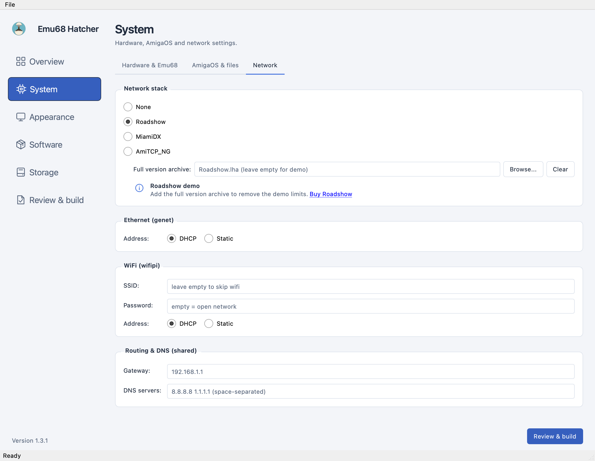
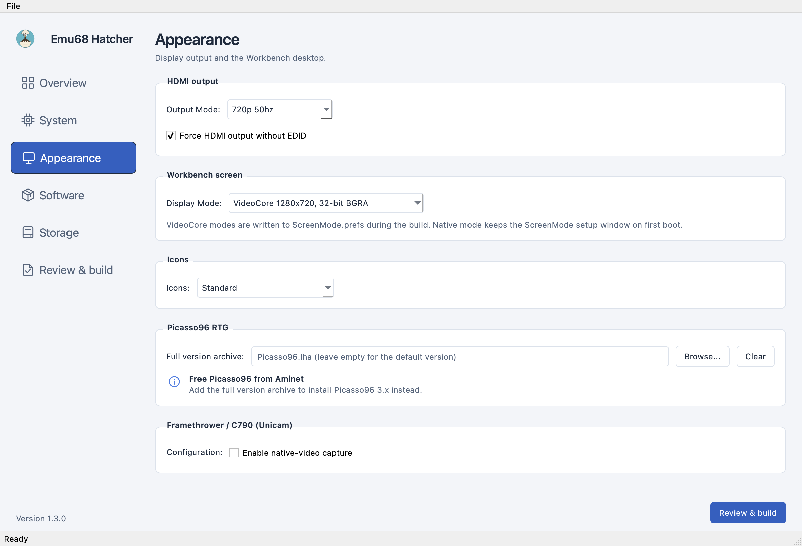
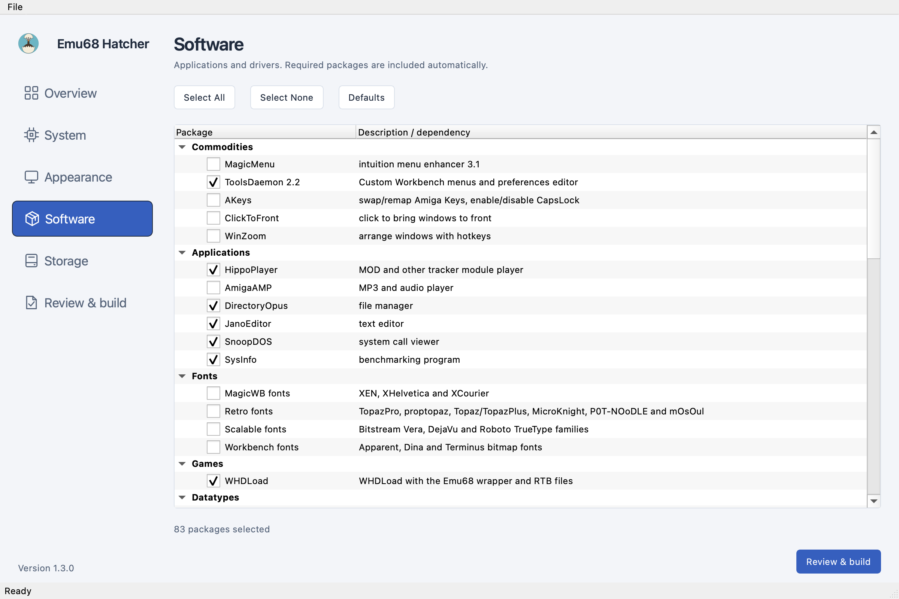
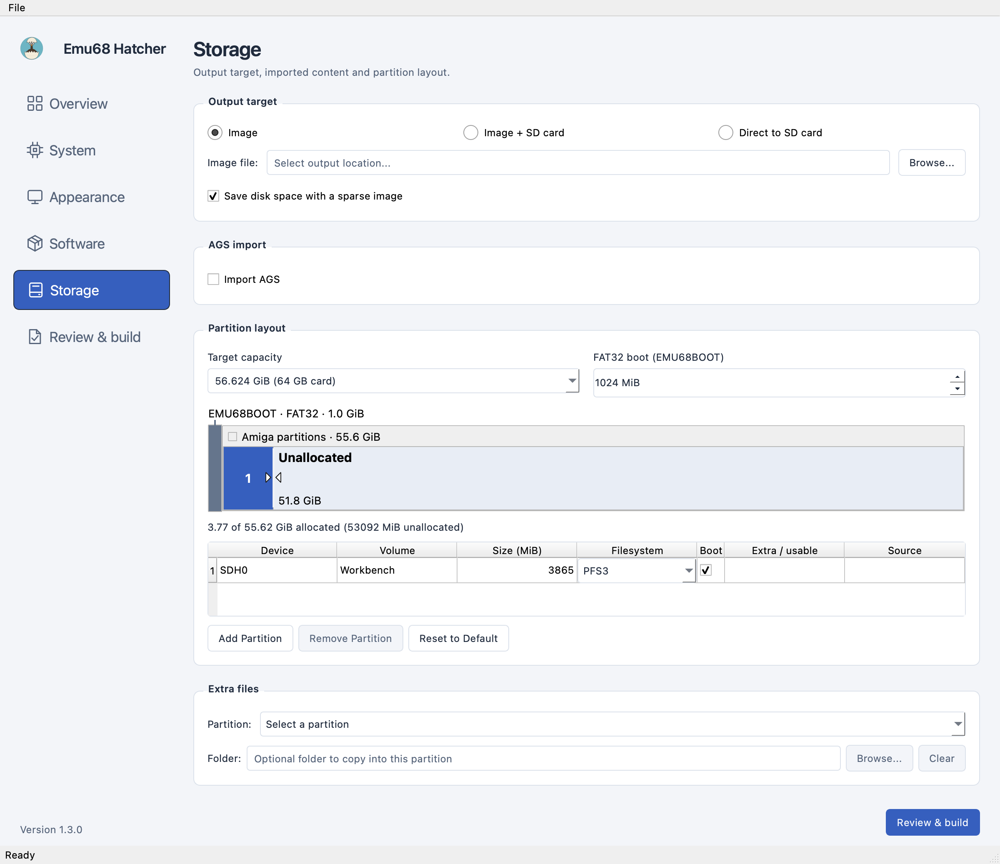
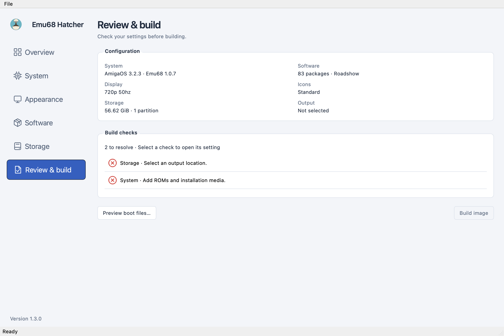

# Usage

## Choose a work area

The sidebar has six areas; visit them in any order. **Load Configuration…** and
**Save Configuration…** are in the File menu. Settings are not saved
automatically, and WiFi passwords are never written to configuration files.

### Overview

**Updates and tools** shows the application version, the package list and the
host tools (hst-imager, 7-Zip) with their install state. **Check now** repeats
the update check, **Download Missing Tools…** fetches what is not installed yet,
and **Reset App Data…** deletes downloaded tools and cached files.

**Build checks** lists what still blocks a build. Click a check to open its
setting.

[](assets/screenshots/overview.png){ target="_blank" }

### System

**Hardware & Emu68:** select the Emu68 release and hardware settings. Boot,
storage, CPU, compatibility and manual overrides are under **Show advanced
settings**.

[](assets/screenshots/system-hardware.png){ target="_blank" }

**AmigaOS & files:** choose the Workbench version, add the folders that contain
your ROMs and installation media, and select languages. Files are recognised by
content, not by name; **Show details…** lists what was found. AmigaOS 3.9 uses
the CD **.iso** and a Kickstart 3.1 ROM. Do not mount the ISO.

[](assets/screenshots/system-amiga.png){ target="_blank" }

**Network:** choose Roadshow, MiamiDX, AmiTCP_NG or None. The full Roadshow
archive and the MiamiDX registration keys go here, as do DHCP or static
addresses, routing, DNS and WiFi.

[](assets/screenshots/system-network.png){ target="_blank" }

### Appearance

Choose the HDMI output mode and the Workbench screen mode. **Force HDMI output
without EDID**, on by default, keeps the HDMI output on when no monitor is
detected at boot. Native-video capture (C790)
needs Emu68 1.1 or later and a VideoCore Workbench mode. Use **Browse…** to
supply your full **Picasso96.lha** instead of the free Aminet version.

Available icon sets follow the selected OS version and detected media. GlowIcons
needs its matching ADF.

[](assets/screenshots/appearance.png){ target="_blank" }

### Software

Select applications, bundles and hardware drivers. The list is filtered for the
chosen Workbench and Emu68 versions, and **Required packages** shows what gets
added automatically and why. **Select All**, **Select None** and **Defaults**
change the optional packages only. See [Packages](packages.md) for the catalog.

Ethernet, WiFi, USB, NVMe, I2C clock support and diagnostic tools are separate
packages; a network stack brings the Ethernet and WiFi drivers with it. USB and
NVMe are offered only for Emu68 versions that support them.

**Hatcher Prefs** in the **Utilities** group is Hatcher's own network window for
the Amiga: connect, disconnect, check the connection, WiFi name and password,
addresses and DNS. Every network stack installs it. Open it from **Network →
Network Settings** or the **Network Settings** icon in **SYS:Utilities**. Save keeps
the replaced files under **SYS:Emu68-Hatcher/Backup/Network/**.

The **Fonts** group has four optional packs: Workbench (Apparent, Dina,
Terminus), MagicWB (XEN, XHelvetica, XCourier), Retro, and Scalable (Bitstream
Vera, DejaVu, Roboto). Installing a pack does not change the active font.
MagicWB is shareware and requires registration after its evaluation period.

[](assets/screenshots/software.png){ target="_blank" }

### Storage

Choose an output mode:

- **Image:** write an **.img** file, with optional sparse allocation.
- **Image + SD card:** keep the image and then write it to the selected card.
- **Direct to SD card:** skip the image file; large builds can be slower.

For image + card, **Verify after writing** reads the card back and compares it
with the image.

!!! danger "Double-check the target!"
    **Picking the wrong disk will wipe it.** Check the selected device before
    confirming a build.

A selected card sets the capacity; for an image file, pick a card size. If the
partitions no longer fit, the shortfall is shown and nothing is shrunk.

- **AGS import:** tick **Import AGS** and choose the source image. Games, the
  Work partition and Media are separate choices. See [AGS import](ags.md).
- **Partition layout:** edit capacity, device and volume names, boot flags,
  filesystems and sizes, or add and remove partitions. Imported partitions are
  fixed; change them in **AGS import** above.
- **Extra files:** choose a partition and a folder to copy into it. The size
  of the folder and the usable capacity are shown together. Extra files are
  copied last and overwrite generated files with the same name.

The default is a 64 GB card with **EMU68BOOT**, a Workbench partition and the
rest unallocated. Unallocated capacity is not free space inside a filesystem.

[](assets/screenshots/storage.png){ target="_blank" }

### Review & build

Review lists the open checks and a summary of the configuration. **Preview boot
files…** shows the config.txt and cmdline.txt the build will write.

The build button is available once the checks pass; SD-card modes warn before
erasing the target. The progress dialog can cancel the build and records
**buildlog.txt**. The first build downloads packages; later builds reuse them.

[](assets/screenshots/review.png){ target="_blank" }

Writing to a card asks for admin access during the build. On macOS, Emu68 Hatcher
also needs Full Disk Access; see [Installation](installation.md#macos).

## Own packages

Package files you put into **packages** inside the Hatcher data folder join the
catalog on that machine: **Library/Application Support/Emu68 Hatcher** on macOS,
**LOCALAPPDATA\Emu68 Hatcher** on Windows, **.local/share/emu68hatcher** on Linux, or
**hatcher_data** in a source checkout. They use the same YAML form as the
bundled packages, show up in the Software work area and survive catalog
updates. A file that does not load is reported in the log and skipped.

## RGB2RTG

RGB2RTG v0.77 is an optional experimental installation for an A1200 with
PiStorm32-lite and a Raspberry Pi 4 or CM4. Pi 3 is not tested. Enable it in
**System → Hardware & Emu68** and browse to your local
**RGB2RTG_A1200_v0.77.7z** release from
[the author](https://astair86.itch.io/rgb2rtg-amiga1200). The archive is not
included or downloaded automatically.

Choose PAL (1080p50) or NTSC (1080p60); this sets the HDMI mode while RGB2RTG is
enabled. Use a VideoCore Workbench screen mode and leave native-video capture
off. Enabling RGB2RTG switches the build to Emu68 1.1.0-beta.1.

The desktop menu is **System → RGB2RTG**, with **Init...**, **Settings...**,
**Sound...** and **About...**. New installations start with the picture off: the
RTG desktop shows, but native Amiga screens stay black on HDMI. Turn the picture
on through **Init...** or with **C:rgb2rtg ON**; the choice is saved for later
boots. The sound monitor from **Sound...** is also
**SYS:Utilities/RGB2RTG-SoundMonitor**. The upstream installer's optional
RGB2RTG-Native launcher is not installed.

Power cycle the Amiga after installation and after changing the video standard
or HDMI rate.

With the AHI package installed, the RGB2RTG HDMI driver for AHI is placed in
**DEVS:AHI**. Switch AHI programs to it under **Sound...** (HiFi) or with
**C:rgb2rtg AHI=ON**. A game's own picture settings (**Settings for**) need
WHDLoad's **S:WHDLoad-Startup**, which Hatcher does not create.

The WHDLoad wrapper disturbs the RGB2RTG picture, so RGB2RTG builds start with
the plain WHDLoad in **C:**. **Games → WHDLoad wrapper on/off** swaps the two at
any time; the same switch is **Execute S:WHDLoadWrapper-Switch** in a Shell.

To return to the standard kernel and driver, run this from an Amiga Shell and
power cycle afterwards:

```text
Execute SYS:Emu68-Hatcher/RGB2RTG/Recover
```

If recovery reports a failure, follow the restore step it names before power
cycling. Extra files that replace the kernel, driver, monitor icon or startup
files can break RGB2RTG and its recovery.
